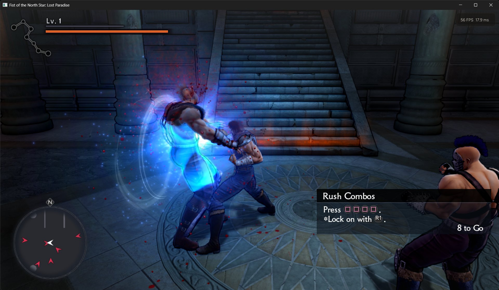
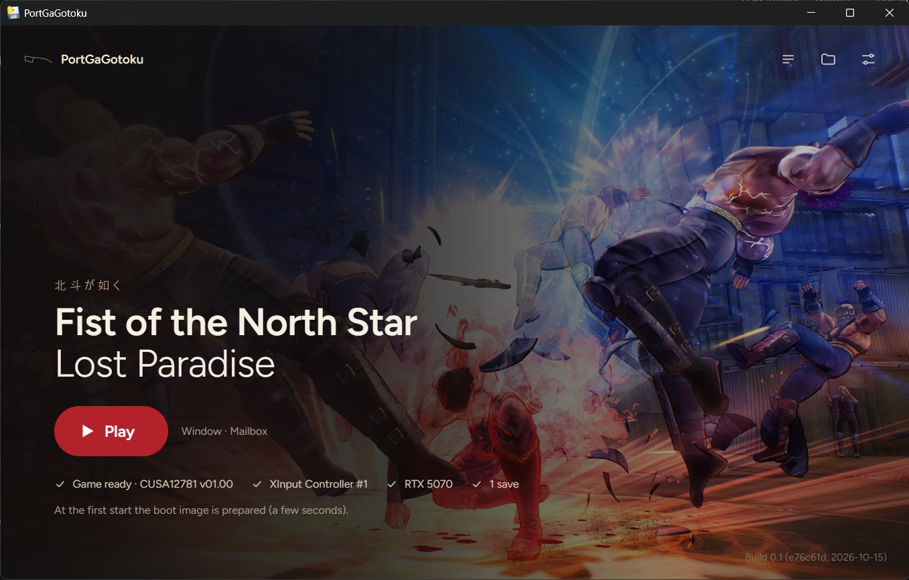

# PortGaGotoku

[English](README.md) · **Italiano**

**[Download: ultima release](https://github.com/ItalianKuze/port-ga-gotoku/releases)**

> **Lo sviluppo è in pausa. La v0.1.4-alpha è l'ultima release.**
> Grazie ai tester, Joshuffle, Virtual-Pie e Lockefinder, e a bbport e shadPS4, sul cui lavoro è
> costruito questo port.

> **Nota:** "nativo" si riferisce solo alla CPU: il codice x86 del gioco gira direttamente sulla CPU,
> mentre le librerie di sistema PS4 sono reimplementate (HLE). La grafica è tradotta in Vulkan tramite il
> video core di shadPS4 incluso nel repo (`gpu/shadps4`). Non è una ricompilazione completa né una
> riscrittura del renderer.

PortGaGotoku fa girare *Fist of the North Star: Lost Paradise* (*Hokuto ga Gotoku*, PlayStation 4,
CUSA12781) su Windows, "come un port". È un fork di
[bbport](https://github.com/deadinside28/bloodborne_pc), il port nativo per PC di Bloodborne di
deadinside28: il codice x86-64 del gioco gira direttamente sulla CPU, un runtime sostituisce le librerie
di sistema della PS4 e la grafica viene tradotta in Vulkan da un renderer derivato da
[shadPS4](https://github.com/shadps4-emu/shadPS4).

> **Nessun file del gioco è incluso.** Serve un proprio dump legale del gioco (la cartella CUSA12781 con
> `eboot.bin` e `sce_sys`). Progetto non ufficiale, non affiliato né approvato da SEGA, Ryu Ga Gotoku
> Studio, Sony Interactive Entertainment o dai detentori dei diritti di Fist of the North Star.

## Funzionalità

- Niente firmware né moduli di sistema della PS4: basta il proprio dump del gioco.
- Un launcher che controlla la cartella del gioco, prepara l'immagine di boot e conserva le impostazioni.
- Salvataggi: lista dei salvataggi a schermo nel gioco, pagina Salvataggi nel launcher, backup
  automatici, import ed export da e verso shadPS4 e PS4 (salvataggi decifrati).
- Un menu in gioco (Insert o L3+R3) e un HUD delle statistiche (F11).
- Gli Special Pack dell'aggiornamento 01.09, letti dalla cartella patch accanto al dump.
- Alt+Invio passa tra finestra e schermo intero.
- Windows, e Linux come AppImage sperimentale.
- Il minigioco del bartender: il giroscopio di DualShock 4 o DualSense, oppure lo stick destro su e giù.

*Combattimento nella prima zona (in finestra, HUD delle statistiche in alto a destra).*

*Il launcher.*

## Stato

**Early alpha, sviluppo in pausa.** Aspettati bug; la v0.1.4-alpha è l'ultima release.

Sperimentale. Sviluppato su Windows 11 con una NVIDIA GeForce RTX 5070 e un controller 8BitDo in
modalità XInput; dei tester l'hanno giocato su schede AMD Radeon (Windows e Linux) e su una GPU da 4 GB.
Linux: sperimentale, come AppImage; Steam Deck non ancora provato.

Funziona: loghi, schermata del titolo e menu, audio, filmati, gameplay (esplorazione e combattimento),
controller e tastiera, salvataggio e caricamento (Continua), il launcher, il menu in gioco, l'HUD delle
statistiche. Problemi noti e prossimi passi: [docs/STATUS_AND_ROADMAP.md](docs/STATUS_AND_ROADMAP.md),
in inglese. In breve: in cammino circa 60 FPS, con cali occasionali; finora poche macchine provate.

L'edizione asiatica, CUSA10053, è stata segnalata funzionante da un tester come prova sperimentale (dal
prologo al primo salvataggio del capitolo 1, testi in cinese tradizionale); il launcher chiede una
conferma prima di avviare un'altra edizione. La versione provata resta CUSA12781 01.00.

## Download

1. Scarica lo `.zip` dell'ultima release da [Releases](https://github.com/ItalianKuze/port-ga-gotoku/releases).
2. Estrailo in una cartella in cui puoi scrivere (non `Programmi`).
3. Controlla i [requisiti](README.md#requirements) (Windows 10/11 a 64 bit, CPU con AVX, BMI1, MOVBE,
   LZCNT e POPCNT, scheda video Vulkan 1.3, WebView2) e tieni pronto il tuo dump del gioco. Il gioco
   riserva circa 6 GB di memoria: con 16 GB di RAM conviene chiudere le altre applicazioni pesanti.
4. Avvia `PortGaGotoku.exe`. Al primo avvio chiede la cartella del gioco: scegli la cartella CUSA12781
   (quella con `eboot.bin` e `sce_sys`). Il launcher la controlla, prepara l'immagine di avvio (i file
   del gioco vengono solo letti) e avvia il gioco. In seguito `Start Hokuto.exe` avvia direttamente il
   gioco con le impostazioni salvate.
   L'aggiornamento 01.09 (gli Special Pack gratuiti): metti la sua cartella accanto al dump, con lo
   stesso nome più `-patch` o `-UPDATE` (`CUSA12781-patch`); i suoi file vengono letti al posto di quelli
   del gioco base. Solo i dati: il suo `eboot.bin`, i moduli e `sce_sys` vengono ignorati, il port usa
   l'eboot 01.00.
5. Gli eseguibili non sono firmati: al primo avvio Windows SmartScreen può mostrare "Windows ha
   protetto il PC". Fai clic su **Ulteriori informazioni** → **Esegui comunque**. Il launcher è
   impacchettato con PyInstaller, quindi anche un antivirus potrebbe segnalarlo.

I log sono in `PortGaGotoku-data\logs\`, accanto alla cartella estratta. Per segnalare un problema apri
una [issue](https://github.com/ItalianKuze/port-ga-gotoku/issues/new/choose) con il modulo di
segnalazione e allega il log della sessione. I log possono contenere il tuo nome utente di Windows (nei
percorsi dei file): puoi sostituirlo prima di allegarli.

## Requisiti, compilazione e avvio

Come nel [README in inglese](README.md#requirements) e in [docs/BUILDING.md](docs/BUILDING.md). Il
launcher è in inglese e in italiano (selettore della lingua nelle Impostazioni); il menu in gioco anche
(Insert o L3+R3). F11: HUD delle statistiche. Alt+Invio: finestra / schermo intero (solo per la sessione). Per uscire: la X della finestra (Alt+F4 a schermo intero);
un salvataggio in corso viene prima completato.

Tastiera (anche con un controller collegato): WASD levetta sinistra, frecce levetta destra, **Spazio** Croce,
**V** Cerchio, **E** Quadrato, **Q** Triangolo, **1**/**3** L1/R1, **R**/**F** L2/R2, **Z**/**C** L3/R3,
**Invio** Options, **Tab**/**Backspace** touchpad sinistra/destra, **IJKL** croce direzionale. I tasti si
cambiano in `pgg.ini` (`key.circle=...`). Mentre un tasto Windows è premuto la tastiera non manda niente al
gioco, così scorciatoie come Win+Shift+S non premono tasti nel gioco. Fino alla 0.1.2 Cerchio era Shift
sinistro.

Tutto ciò che il port scrive va in `PortGaGotoku-data`, accanto alla cartella del progetto o del
pacchetto: impostazioni, immagine di avvio, salvataggi (`user/savedata/1/CUSA12776`), backup dei
salvataggi, log, cache degli shader.

## Sviluppo, crediti, licenza

Vedi il [README in inglese](README.md#development). Il progetto è stato sviluppato con l'aiuto di un
assistente di programmazione basato su IA, sotto la direzione e con le prove del suo curatore.
Licenza: GNU GPL v2 o successiva ([LICENSE](LICENSE)).
