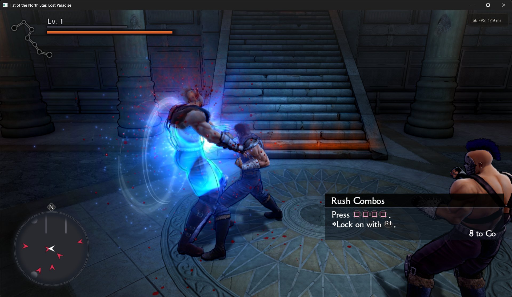
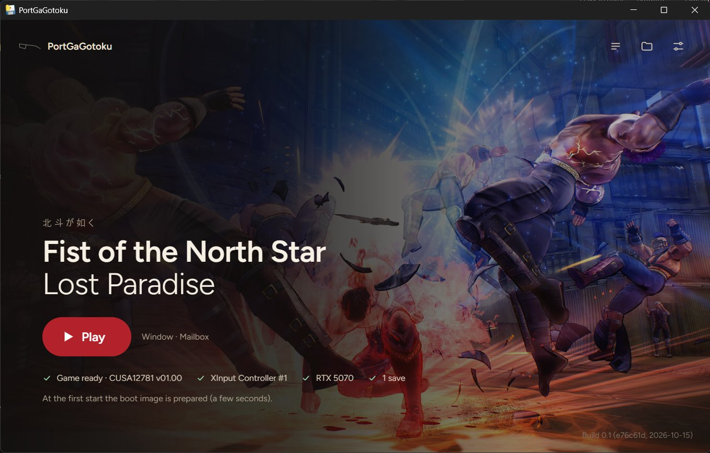

# PortGaGotoku

**English** · [Italiano](README.it.md)

**[Download: latest release](https://github.com/ItalianKuze/port-ga-gotoku/releases)**

> **Note:** "native" refers only to the CPU side: the game's x86 code runs directly on the host CPU,
> while PS4 system libraries are reimplemented (HLE). Graphics are translated to Vulkan through the
> shadPS4 video core included in this repo (`gpu/shadps4`). This is not a full recompilation or a
> rewrite of the renderer.

PortGaGotoku runs *Fist of the North Star: Lost Paradise* (*Hokuto ga Gotoku*, PlayStation 4,
CUSA12781) on Windows — "like a port". It is a fork of
[bbport](https://github.com/deadinside28/bloodborne_pc), deadinside28's native PC port of
Bloodborne: the game's own x86-64 code runs directly on the CPU, a runtime replaces the PS4 system
libraries, and the graphics are translated to Vulkan by a renderer derived from
[shadPS4](https://github.com/shadps4-emu/shadPS4).

> **No game files are included.** You need your own legal dump of the game (the CUSA12781 folder with
> `eboot.bin` and `sce_sys`). This is an unofficial project, not affiliated with or endorsed by SEGA,
> Ryu Ga Gotoku Studio, Sony Interactive Entertainment or the rights holders of Fist of the North
> Star. It is not related to shadPS4 either: please do not ask about it on shadPS4's channels, nor
> on bbport's (its issues are not upstream's).


*Combat in the first area (window mode, statistics HUD at the top right).*


*The launcher.*

## Status

**Early alpha, developed slowly in my spare time.** Expect bugs; no release schedule.

Experimental, playable on the one machine it was tested on (Windows 11, NVIDIA GeForce RTX 5070,
8BitDo controller in XInput mode).

What works: logos, title screen and menus, audio, movies, gameplay (exploration and combat),
gamepad and keyboard, saving and loading (Continue), the launcher, the in-game menu, the statistics
HUD. Known issues and next steps: [docs/STATUS_AND_ROADMAP.md](docs/STATUS_AND_ROADMAP.md). In short:
about 60 FPS while walking, with occasional drops; only one machine has been tested.

bbport's Bloodborne-specific parts (its patches and mods, hooks in Bloodborne's code, its menu
entries, launcher and Linux packaging) are not in this fork; the renderer, runtime and tools they
were built on are.

## Requirements

- 64-bit Windows 10 or 11.
- A CPU with AVX, BMI1, MOVBE, LZCNT and POPCNT (the game's code was compiled for the PS4's CPU).
- A graphics card with Vulkan 1.3 and a current driver.
- Memory: the game reserves about 6 GB. With 16 GB of RAM, close other heavy applications before
  playing.
- Microsoft Edge WebView2 Runtime for the launcher's window (part of Windows 11).
- Your own dump of Fist of the North Star: Lost Paradise, CUSA12781, version 01.00 (the only one
  tested). The Asian edition, CUSA10053, was reported working by a tester as an experimental try
  (from the prologue to the first save of chapter 1, texts in traditional Chinese); the launcher asks
  for a confirmation before starting another edition.

## Download

1. Download the `.zip` of the latest release from [Releases](https://github.com/ItalianKuze/port-ga-gotoku/releases).
2. Extract it to a folder you can write to (not `Program Files`).
3. Check the [requirements](#requirements) above and have your dump of the game ready.
4. Start `PortGaGotoku.exe`. At the first start it asks for the game folder: choose the CUSA12781
   folder (the one with `eboot.bin` and `sce_sys`). The launcher checks it, prepares the boot image
   (the game files are only read) and starts the game. Later, `Start Hokuto.exe` starts the game
   directly with the saved settings.
5. The executables are not signed: at the first start Windows SmartScreen may show "Windows protected
   your PC". Click **More info** → **Run anyway**. The launcher is frozen with PyInstaller, so an
   antivirus may warn about it too.

Logs are in `PortGaGotoku-data\logs\`, next to the extracted folder (see [Data folder](#data-folder)).
To report a problem, open an [issue](https://github.com/ItalianKuze/port-ga-gotoku/issues/new/choose)
with the bug report form and attach the log of the run. Logs can contain your Windows user name (in
file paths): you can replace it before attaching them.

## Build and run

Windows, MSYS2 UCRT64 shell: [docs/BUILDING.md](docs/BUILDING.md). In short:

```sh
bash scripts/build-win.sh                     # out-win/run: bb-probe.exe and its DLLs
out-win/pyenv-ui/Scripts/pythonw.exe launcher/pgg_main.py   # the launcher, from the sources
bash packaging/windows/package.sh             # or a package: dist/PortGaGotoku-<version>.zip
```

The launcher asks for the game folder at the first start, checks it (eboot.bin, TITLE_ID
CUSA12781), prepares the boot image from it (the game files are only read) and starts the game.
`scripts/Start Hokuto.cmd` starts it without the launcher once that is done.

In the game: **Insert** or **L3+R3** opens the port's menu, **F11** the statistics HUD, **F9** starts a
90-second performance measurement. Close the game with the window's X (Alt+F4 in fullscreen): a save in
progress is finished first.

Linux: not maintained in this fork for now (the code stays portable; see the roadmap).

## Data folder

Everything the port writes goes to `PortGaGotoku-data`, next to the project (or package) folder
(`BB_DATA_DIR` changes it):

| Folder / file | What |
|---|---|
| `launcher.json`, `bbport.ini` | launcher settings, in-game menu settings |
| `out/` | the boot image prepared from your dump |
| `user/savedata/1/CUSA12776/` | saves (one folder per slot, plus `<slot>.sce_sys`) |
| `save-backups/` | a copy of a slot before the game writes it (the last 10 per slot) |
| `logs/` | game logs, performance measurements |
| `cache/`, `gpu/` | shader cache and the GPU library's folder (never `%APPDATA%\shadPS4`) |

## Development

Notes on what was changed and why: [docs/TECHNICAL_NOTES.md](docs/TECHNICAL_NOTES.md). Commit titles
carry their scope: `[common]` (all platforms) or `[windows]`. Benchmarks:
`scripts/bench_hokuto.py` (a recorded route replayed with a measurement, see the roadmap). This
project was developed with the help of an AI coding assistant, under the direction and testing of its
maintainer.

bbport's own documents (Bloodborne, upstream history) are kept in `docs/upstream-bbport/`.

## Credits

Started as a fork of bbport by deadinside28 (https://github.com/deadinside28/bloodborne_pc),
GPL-2.0-or-later.

- **deadinside28** — [bbport](https://github.com/deadinside28/bloodborne_pc), the base of everything
  here: runtime, loader, renderer, tools.
- **shadPS4** — [shadPS4](https://github.com/shadps4-emu/shadPS4): the video core and shader
  recompiler bbport's renderer derives from, and the reference for the PS4 libraries.
- **Supermedo** — [Supermedo/bloodborne_pc](https://github.com/Supermedo/bloodborne_pc): the Windows
  launcher and package the launcher's structure and `packaging/windows` are based on.
- **Mrsuss60** — [bloodborne_pc_windows_port](https://github.com/Mrsuss60/bloodborne_pc_windows_port):
  the fault-recovery layout on Windows and the telemetry HUD the statistics HUD is based on.
- **Phroster** — [bloodborne_pc_windows](https://github.com/Phroster/bloodborne_pc_windows): Windows
  port research (TLS in the TEB, exception handling, the MSYS2 build).
- Fonts: [Figtree](https://github.com/erikdkennedy/figtree) by Erik Kennedy (SIL Open Font License 1.1,
  `launcher/ui/fonts/Figtree-OFL.txt`, `gpu/third_party/fonts/LICENSE-Figtree.txt`) and DejaVu Sans
  (Bitstream Vera license, `gpu/third_party/fonts/LICENSE-DejaVu.txt`).
- Third-party components inherited from bbport keep their licenses: sirit, half, LibAtrac9 (MIT), Dear
  ImGui (MIT), and the others under `gpu/third_party` and `third_party`. The launcher window uses
  [pywebview](https://pywebview.flowrl.com/) (BSD).

## License

GNU GPL v2 or later ([LICENSE](LICENSE)), as bbport and shadPS4. The Windows package as a whole is
GPL-2.0-or-later too; its third-party components and their licenses are listed in
`THIRD_PARTY_NOTICES.txt` and `licenses\`.
